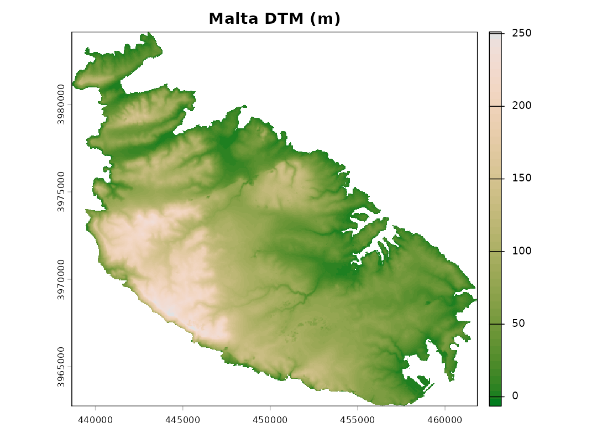
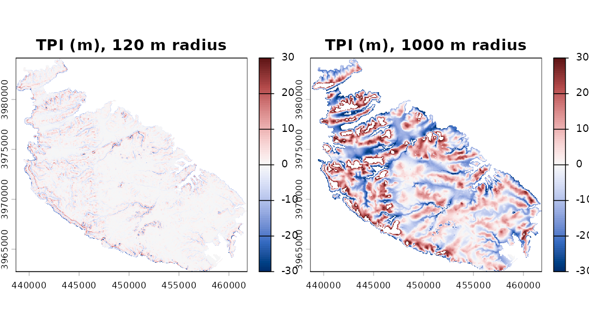
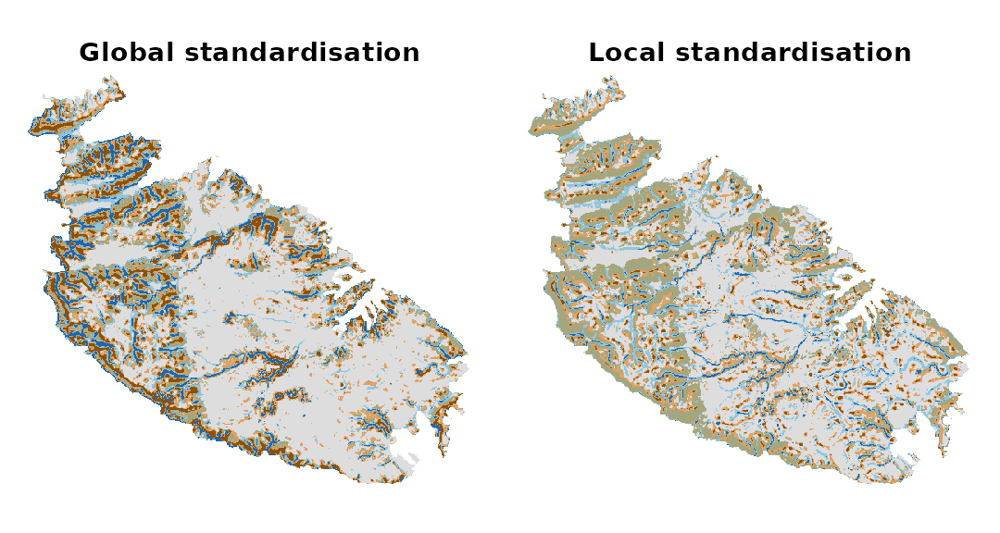
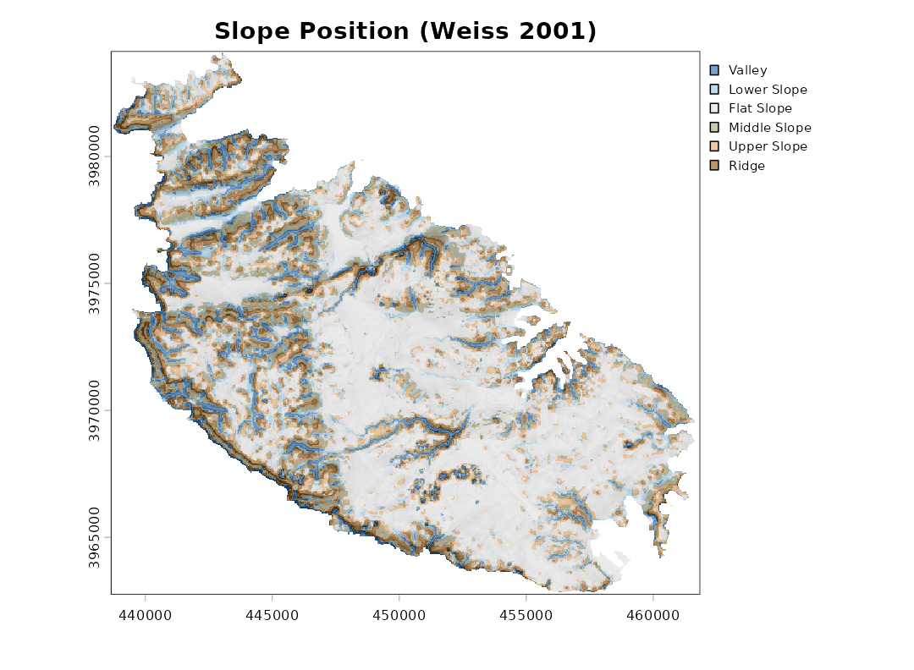
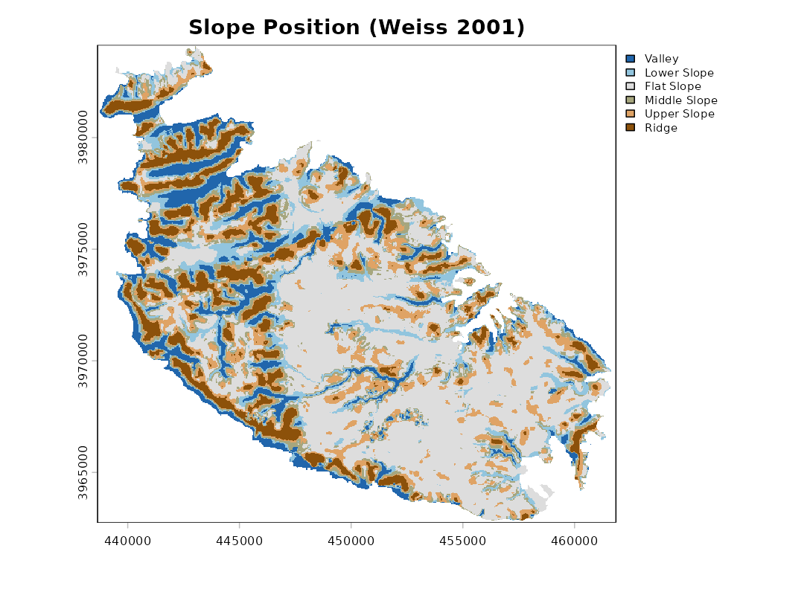
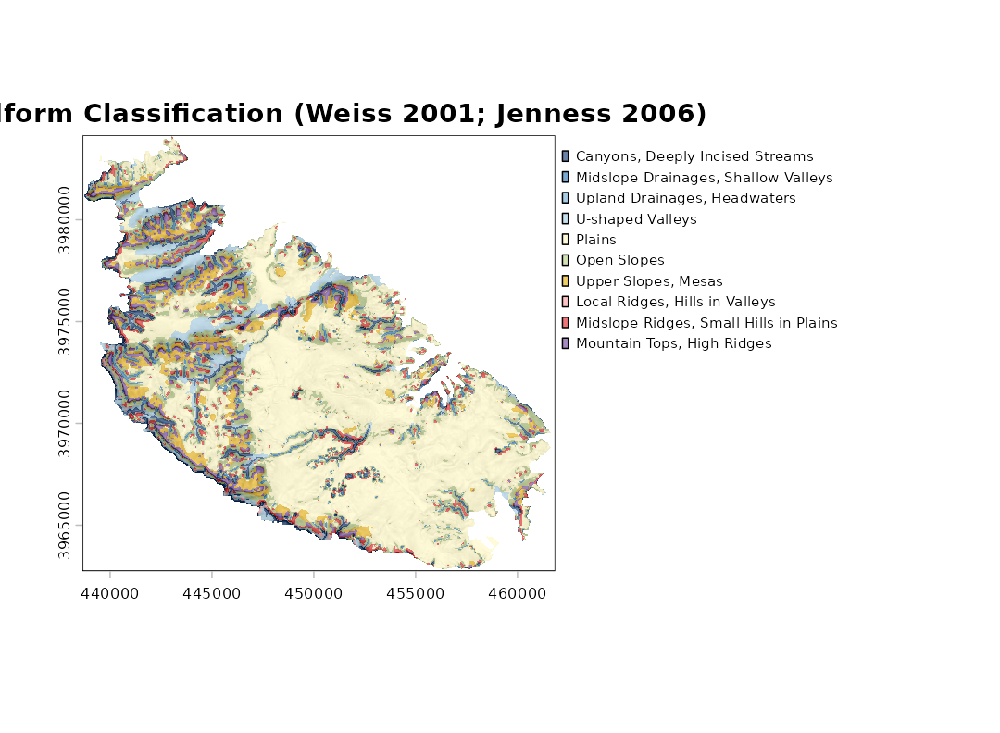
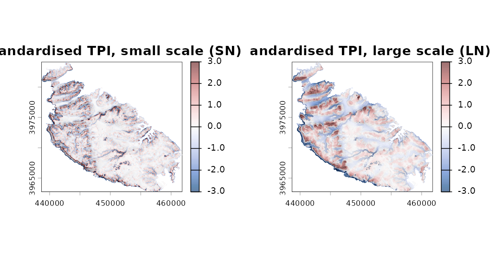
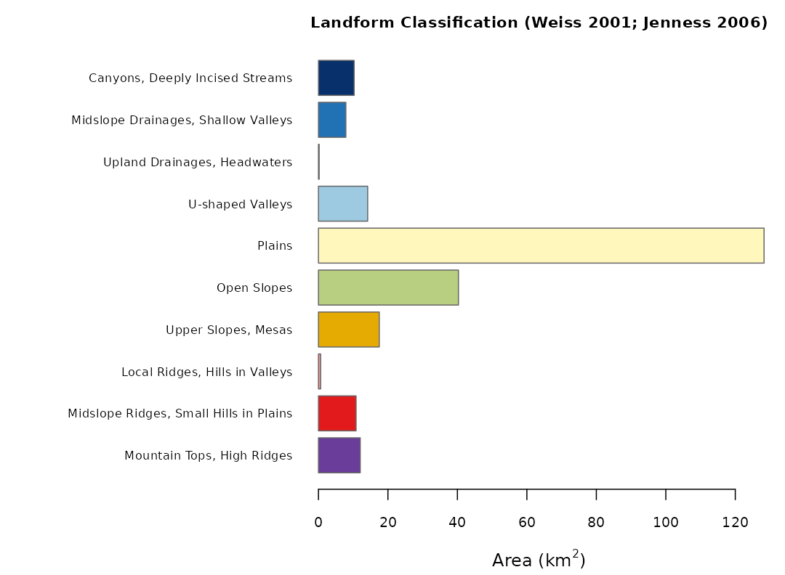
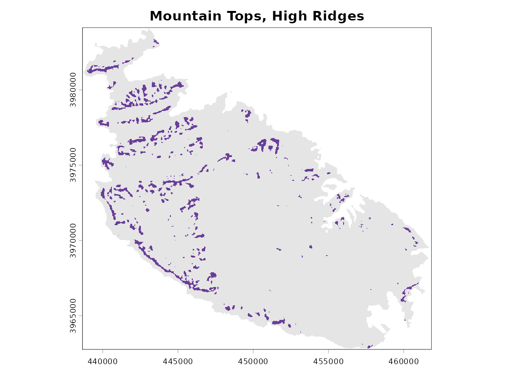

# Landform classification with the Topographic Position Index

## What the package does

The Topographic Position Index (TPI) compares the elevation of each cell
of a digital terrain model (DTM) with the mean elevation of the cells
around it (Guisan et al. 1999; Weiss 2001). Positive values mean that
the cell is higher than its surroundings (a ridge or a hilltop),
negative values that it is lower (a valley bottom), and values near zero
that it is either on flat ground or half-way up a slope; slope is used
to tell these two apart.

`landform` implements the two classifications proposed by Weiss (2001)
and made popular by Jenness’s TPI extension for ArcView (Jenness 2006):

- the **Slope Position Classification**, six classes from one TPI scale;
- the **Landform Classification**, ten classes from a small and a large
  TPI scale.

The package has three functions:
[`landform()`](https://gianmarcoalberti.github.io/landform/reference/landform.md),
which performs the classifications;
[`tpi()`](https://gianmarcoalberti.github.io/landform/reference/tpi.md),
which returns the TPI surface itself; and
[`malta_dtm()`](https://gianmarcoalberti.github.io/landform/reference/malta_dtm.md),
which loads the sample DTM used below.

## The sample data

The DTM covers the island of Malta at 40 m resolution, with the sea
coded as `NA`.

``` r

library(landform)
library(terra)
#> terra 1.9.50

dem <- malta_dtm()
dem
#> class       : SpatRaster
#> size        : 535, 580, 1  (nrow, ncol, nlyr)
#> resolution  : 40, 40  (x, y)
#> extent      : 438651.4, 461851.4, 3962750, 3984150  (xmin, xmax, ymin, ymax)
#> coord. ref. : ED50 / UTM zone 33N (EPSG:23033)
#> source      : malta_dtm_40.tif
#> name        : elevation
plot(dem, col = hcl.colors(50, "Terrain 2"), main = "Malta DTM (m)")
```



## The Topographic Position Index

The TPI depends entirely on the size of the neighbourhood: the same
point can be a ridge with respect to its immediate surroundings and part
of a valley floor at a broader scale. The neighbourhood is set by
`scale`, interpreted either as the width of a square window in cells
(`units = "cells"`, the default) or as a radius in map units
(`units = "map"`; metres for longitude/latitude rasters). The window can
be square, circular or annular (`shape`).

``` r

t_small <- tpi(dem, scale = 120, units = "map", shape = "circle", std = "none")
t_large <- tpi(dem, scale = 1000, units = "map", shape = "circle", std = "none")
rng <- c(-30, 30)
plot(c(t_small, t_large), range = rng,
     col = hcl.colors(100, "Blue-Red 3"),
     main = c("TPI (m), 120 m radius", "TPI (m), 1000 m radius"))
```



### Standardisation

Weiss’s thresholds are expressed in standard deviations, so the TPI has
to be standardised first. Two approaches are available, and they can
lead to noticeably different maps.

- **Global** (`std = "global"`, the default). The TPI is turned into
  z-scores using the mean and standard deviation of the TPI over the
  whole raster. This is the method of Weiss (2001) and Jenness (2006): a
  value of 1 means “one standard deviation above the typical TPI of this
  landscape”.
- **Local** (`std = "local"`). The TPI of each cell is divided by the
  standard deviation of elevation in its own neighbourhood, which is the
  “deviation from mean elevation” (DEV) of Wilson and Gallant (2000). De
  Reu et al. (2013) found it better suited to landscapes in which relief
  varies greatly from place to place. Its drawback is that in nearly
  flat areas the local standard deviation is tiny, so that small
  irregularities of the DTM (or plain noise) become large standardised
  values. This was the only method available in `landform` up to version
  0.2.

The difference is easiest to see on the plateaus and plains of eastern
Malta:

``` r

g <- landform(dem, scale = 9, plot = FALSE)
l <- landform(dem, scale = 9, std = "local", plot = FALSE)
par(mfrow = c(1, 2))
plot(g$classes, main = "Global standardisation", legend = FALSE,
     mar = c(1, 1, 2, 1), axes = FALSE)
plot(l$classes, main = "Local standardisation", legend = FALSE,
     mar = c(1, 1, 2, 1), axes = FALSE)
```



``` r

par(mfrow = c(1, 1))
```

``` r

data.frame(class = g$stats$class,
           global = round(g$stats$percent, 1),
           local = round(l$stats$percent, 1))
#>          class global local
#> 1       Valley    7.7   3.2
#> 2  Lower Slope    8.3  11.7
#> 3   Flat Slope   48.7  43.0
#> 4 Middle Slope   13.3  24.4
#> 5  Upper Slope   12.2  14.3
#> 6        Ridge    9.7   3.4
```

With local standardisation the flat areas are broken up into a mosaic of
valleys and ridges a few cells across. Which method is preferable
depends on the landscape and on the question; when in doubt, it is worth
running both.

## Slope Position Classification

``` r

sp <- landform(dem, scale = 9)
```


``` r

sp
#> <landform> Slope Position Classification (Weiss 2001) 
#>   neighbourhood : scale = 9 in cells (window width) - square (focal cell excluded) 
#>   TPI standard. : global 
#>   classified    : 151209 cells, 242.108 km2
#> 
#>  code        class area_km2 percent
#>     1       Valley   18.525     7.7
#>     2  Lower Slope   20.158     8.3
#>     3   Flat Slope  117.906    48.7
#>     4 Middle Slope   32.303    13.3
#>     5  Upper Slope   29.647    12.2
#>     6        Ridge   23.569     9.7
```

The thresholds (Weiss 2001), with z the standardised TPI and s the slope
in degrees, are:

| Class          | Rule                        |
|:---------------|:----------------------------|
| 1 Valley       | z ≤ -1                      |
| 2 Lower Slope  | -1 \< z ≤ -0.5              |
| 3 Flat Slope   | -0.5 \< z \< 0.5 and s ≤ 5  |
| 4 Middle Slope | -0.5 \< z \< 0.5 and s \> 5 |
| 5 Upper Slope  | 0.5 ≤ z ≤ 1                 |
| 6 Ridge        | z \> 1                      |

All three thresholds can be changed with `tpi.thr` and `slope.thr`.

The classes can be drawn semi-transparently over a relief shading, which
helps relate them to the terrain. A slopeshade (`shade = "slope"`) shows
the slope in grey levels, from white for flat ground to black for the
steepest slopes; unlike a hillshade (`shade = "hill"`), it does not
darken features just because they face away from the light. The opacity
of the classes is set by `alpha`:

``` r

plot(sp, shade = "slope")
```



Since the classification depends on the scale, a broader neighbourhood
picks out broader features:

``` r

sp_broad <- landform(dem, scale = 600, units = "map", shape = "circle")
```



## Landform Classification

The Landform Classification combines a small-neighbourhood TPI (`sn`)
and a large-neighbourhood TPI (`ln`), each split into low (≤ -1), middle
and high (≥ 1) values; plains and open slopes are separated by slope.

``` r

lf <- landform(dem, class.type = "landform.classification",
               sn = 200, ln = 1000, units = "map", shape = "circle",
               shade = "slope")
```



| Class                                    | SN     | LN     |
|:-----------------------------------------|:-------|:-------|
| 1 Canyons, Deeply Incised Streams        | ≤ -1   | ≤ -1   |
| 2 Midslope Drainages, Shallow Valleys    | ≤ -1   | middle |
| 3 Upland Drainages, Headwaters           | ≤ -1   | ≥ 1    |
| 4 U-shaped Valleys                       | middle | ≤ -1   |
| 5 Plains (slope ≤ 5)                     | middle | middle |
| 6 Open Slopes (slope \> 5)               | middle | middle |
| 7 Upper Slopes, Mesas                    | middle | ≥ 1    |
| 8 Local Ridges, Hills in Valleys         | ≥ 1    | ≤ -1   |
| 9 Midslope Ridges, Small Hills in Plains | ≥ 1    | middle |
| 10 Mountain Tops, High Ridges            | ≥ 1    | ≥ 1    |

The two standardised TPI surfaces on which the classification rests can
be plotted directly, here over a slopeshade (the colour scale is capped
at ±3 standard deviations):

``` r

plot(lf, what = "tpi", shade = "slope")
```



## What `landform()` returns

[`landform()`](https://gianmarcoalberti.github.io/landform/reference/landform.md)
returns an object of class `"landform"`, a list holding:

- `classes`: a categorical `SpatRaster` of the classes, with class names
  and colours attached;
- `tpi`: the raw and standardised TPI layers;
- `slope`: the slope (degrees);
- `stats`: the descriptive statistics of each class;
- `dem` and `params`: the input DTM and the settings used.

``` r

summary(lf)
#>    code                                  class cells    area_km2     percent
#> 1     1        Canyons, Deeply Incised Streams  6419  10.2776930  4.24508506
#> 2     2    Midslope Drainages, Shallow Valleys  4925   7.8856255  3.25706859
#> 3     3           Upland Drainages, Headwaters   126   0.2017418  0.08332717
#> 4     4                       U-shaped Valleys  8849  14.1684167  5.85210456
#> 5     5                                 Plains 80119 128.2830591 52.98586948
#> 6     6                            Open Slopes 25170  40.3008156 16.64579694
#> 7     7                    Upper Slopes, Mesas 10931  17.5020090  7.22900727
#> 8     8         Local Ridges, Hills in Valleys   395   0.6324459  0.26122465
#> 9     9 Midslope Ridges, Small Hills in Plains  6763  10.8285440  4.47260786
#> 10   10             Mountain Tops, High Ridges  7512  12.0277066  4.96790844
#>    mean_elev mean_slope
#> 1   57.11573   9.803690
#> 2   85.13888   8.740135
#> 3  130.32629  10.469815
#> 4   54.93890   6.371109
#> 5   72.88148   2.397099
#> 6   81.50629   8.873848
#> 7  137.34029   5.463080
#> 8   94.19899  14.683089
#> 9   84.16005   8.136700
#> 10 134.89600   7.425783
plot(lf, what = "area")
```



Areas are computed from the actual size of each cell
([`terra::cellSize()`](https://rspatial.github.io/terra/reference/cellSize.html)),
so they are correct also for rasters in longitude/latitude. Cells for
which slope cannot be computed (the outer rim of the raster and the
cells along the coast) are left unclassified.

Individual classes can be extracted as separate presence/absence layers
with
[`class_layers()`](https://gianmarcoalberti.github.io/landform/reference/class_layers.md),
for instance to compute distances from ridges or to use the classes as
covariates:

``` r

layers <- class_layers(lf)
names(layers)
#>  [1] "Canyons, Deeply Incised Streams"       
#>  [2] "Midslope Drainages, Shallow Valleys"   
#>  [3] "Upland Drainages, Headwaters"          
#>  [4] "U-shaped Valleys"                      
#>  [5] "Plains"                                
#>  [6] "Open Slopes"                           
#>  [7] "Upper Slopes, Mesas"                   
#>  [8] "Local Ridges, Hills in Valleys"        
#>  [9] "Midslope Ridges, Small Hills in Plains"
#> [10] "Mountain Tops, High Ridges"
plot(layers[["Mountain Tops, High Ridges"]], legend = FALSE,
     col = c("grey90", "#6A3D9A"), main = "Mountain Tops, High Ridges")
```



Since `classes` is an ordinary `SpatRaster`, it can be saved with
[`terra::writeRaster()`](https://rspatial.github.io/terra/reference/writeRaster.html)
and opened in any GIS.

## Reproducing results from landform 0.2

Version 0.3 changed the default standardisation from local to global
and, by default, excludes the focal cell from the neighbourhood mean. To
reproduce results obtained with earlier versions, use:

``` r

landform(dem, scale = 9, std = "local", centre = TRUE)
```

The only remaining differences are that cells on the outer rim of the
raster are now always left unclassified, and that cells whose
standardised TPI was exactly 0.5 (previously left without a class) are
now Upper Slope.

## References

De Reu, J., Bourgeois, J., Bats, M., Zwertvaegher, A., Gelorini, V., De
Smedt, P., Chu, W., Antrop, M., De Maeyer, P., Finke, P., Van Meirvenne,
M., Verniers, J. and Crombé, P. (2013). Application of the topographic
position index to heterogeneous landscapes. *Geomorphology*, 186, 39-49.

Guisan, A., Weiss, S. B. and Weiss, A. D. (1999). GLM versus CCA spatial
modeling of plant species distribution. *Plant Ecology*, 143, 107-122.

Jenness, J. (2006). *Topographic Position Index (tpi_jen.avx) extension
for ArcView 3.x, v. 1.2*. Jenness Enterprises.

Weiss, A. (2001). *Topographic Position and Landforms Analysis*. Poster
presentation, ESRI User Conference, San Diego, CA.

Wilson, J. P. and Gallant, J. C. (eds) (2000). *Terrain Analysis:
Principles and Applications*. Wiley, New York.
